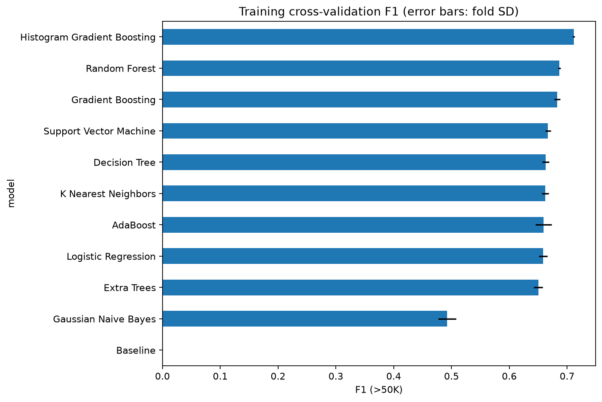
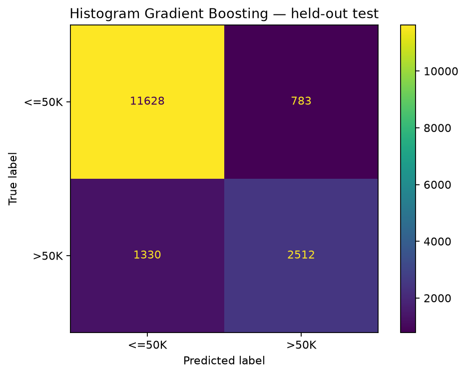
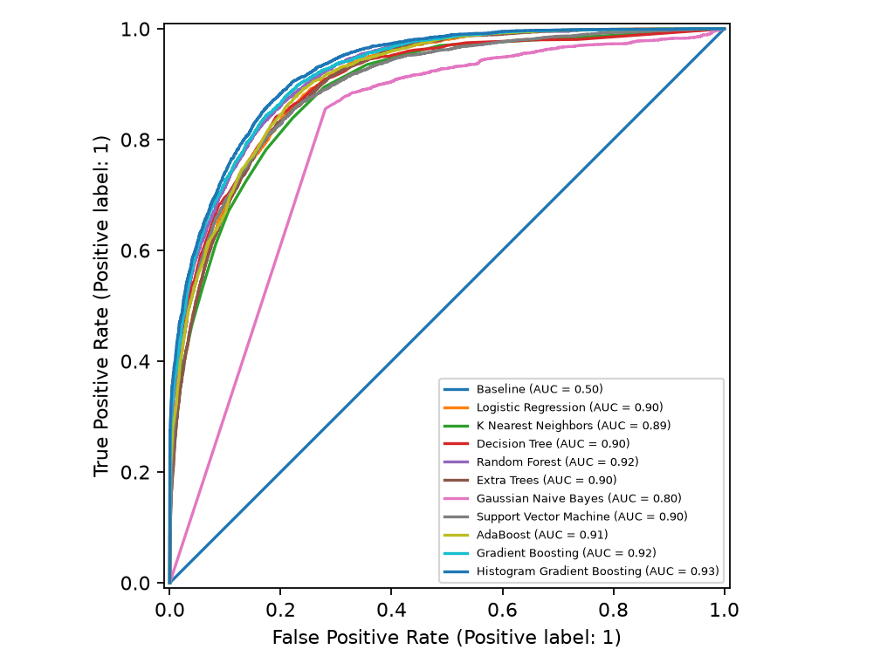
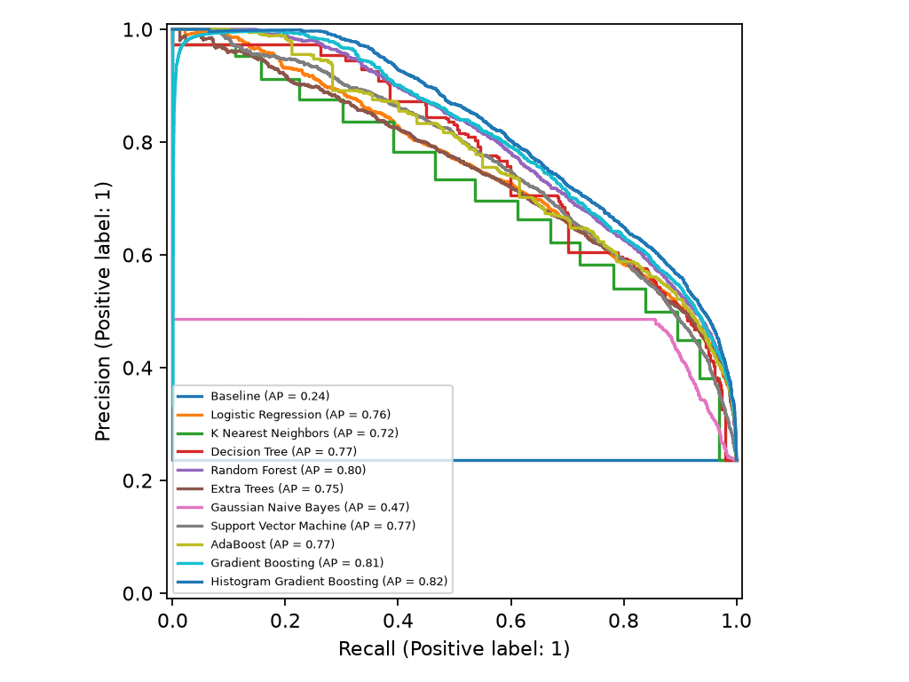
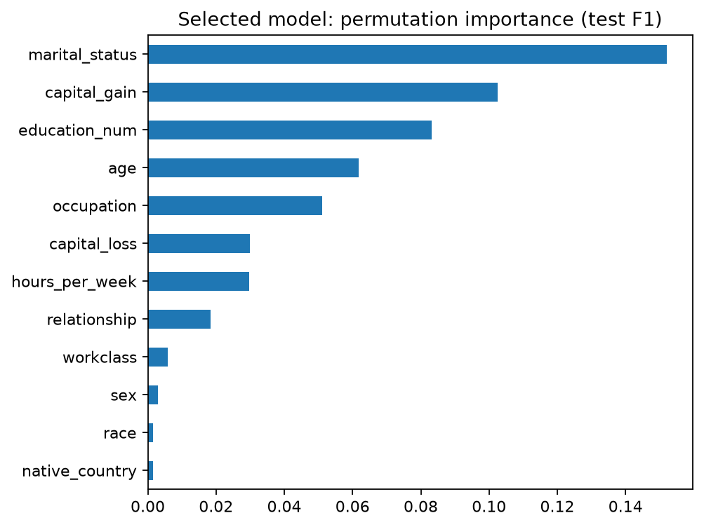

# Census Income Classification: A Comparative Study of 10 ML Models

A reproducible machine learning project comparing **10 classification algorithms** on the **UCI Adult Census Income dataset** to predict whether annual income exceeds **$50,000**.

The study combines exploratory analysis, cross-validation, hyperparameter tuning, model evaluation, and visualizations to examine predictive performance, computational cost, and prediction errors.

## Key Results

**Histogram Gradient Boosting** was selected using training cross-validation and achieved the highest held-out test F1-score among the evaluated models.

| Metric | Selected Model |
| --- | ---: |
| Accuracy | 87.00% |
| F1-score | 0.7039 |
| ROC-AUC | 0.9257 |
| Majority-class baseline accuracy | 76.36% |
| Accuracy improvement over baseline | 10.64 percentage points |

The positive class is **income >$50K**. Model selection used training cross-validation; the test set was reserved for final evaluation.

## Test Performance Comparison

| Model | Accuracy | F1-score | ROC-AUC |
| --- | ---: | ---: | ---: |
| Histogram Gradient Boosting | 87.00% | 0.7039 | 0.9257 |
| Gradient Boosting | 86.81% | 0.6844 | 0.9193 |
| Random Forest | 86.56% | 0.6822 | 0.9169 |
| Decision Tree | 86.10% | 0.6683 | 0.9020 |
| Support Vector Machine | 85.74% | 0.6600 | 0.8972 |
| Logistic Regression | 85.21% | 0.6554 | 0.9032 |
| AdaBoost | 85.45% | 0.6526 | 0.9078 |
| K-Nearest Neighbors | 84.49% | 0.6507 | 0.8898 |
| Extra Trees | 85.01% | 0.6415 | 0.9016 |
| Gaussian Naive Bayes | 53.74% | 0.4921 | 0.8006 |
| Majority-Class Baseline | 76.36% | 0.0000 | 0.5000 |

Rows are ordered by test F1-score for presentation, not for model selection. These results describe this dataset and experimental setup, rather than a universal ranking of the algorithms.

## Main Findings

- **Accuracy alone can be misleading:** the majority-class baseline achieved 76.36% accuracy but had an F1-score of zero because it never predicted the higher-income class.
- **Boosting performed strongly:** Histogram Gradient Boosting and Gradient Boosting achieved the two highest test F1-scores and ROC-AUC values.
- **Random Forest was competitive:** it achieved an F1-score of 0.6822 and an accuracy of 86.56%.
- **Metric choice changes the interpretation:** Gaussian Naive Bayes achieved a ROC-AUC of 0.8006 but only 53.74% accuracy at its default classification threshold.

## Visualizations

### Cross-Validation Comparison

Mean training cross-validation F1-scores. Error bars show standard deviation across folds, not confidence intervals.



### Confusion Matrix

Correct predictions and classification errors for the selected model on the held-out test set.



### ROC Curves

Comparison of model discrimination across classification thresholds.



### Precision–Recall Curves

Comparison of precision and recall for the higher-income class.



### Feature Importance

Permutation importance measures how shuffling each original feature affects the selected model’s test F1-score. It describes model dependence, not causation.



## Dataset

**Source:** [UCI Adult dataset](https://archive.ics.uci.edu/dataset/2/adult)  
**DOI:** [10.24432/C5XW20](https://doi.org/10.24432/C5XW20)  
**Dataset license:** CC BY 4.0

The target has two classes:

- `0`: annual income ≤$50K
- `1`: annual income >$50K

Features include age, education level, occupation, workclass, working hours, capital gains, and other demographic attributes.

This project uses **Adult**, also known as Census Income, rather than the separate Census Income (KDD) dataset. Raw files are downloaded automatically and excluded from Git.

## Methodology

1. **Data preparation:** preserve the official training/test partition, remove exact duplicate records, and remove exact full-record overlaps from the test partition.
2. **Feature preparation:** exclude `fnlwgt`, a survey weight, and the redundant text feature `education`, while retaining `education_num`. Evaluation metrics are unweighted.
3. **Preprocessing:** impute numerical values using the median and categorical values using the most frequent category. Apply numerical scaling and one-hot encoding.
4. **Cross-validation:** evaluate all models using the same five stratified folds. Fit preprocessing inside each fold to prevent leakage.
5. **Model selection and tuning:** rank models using mean cross-validation F1-score. Tune the top two non-baseline models using three parameter settings each, exclusively within the training data.
6. **Final evaluation:** freeze the selected model before evaluating the held-out test set.
7. **Interpretation:** generate permutation importance, misclassification records, and subgroup diagnostics.

The full run tuned **Histogram Gradient Boosting** and **Random Forest**. The selected model’s test row uses its tuned configuration; other test rows use their initial configurations.

## Technologies

- Python
- pandas and NumPy
- scikit-learn
- Matplotlib
- joblib
- Git and GitHub

## Project Structure

```text
census-income-ml-comparison/
├── data/
│   └── README.md
├── results/
│   ├── README.md
│   ├── quick/
│   └── full/
├── src/
│   └── train.py
├── .gitignore
├── requirements.txt
└── README.md
```

## Run Locally

Python **3.11 or 3.12** is recommended.

### 1. Clone the repository

```powershell
git clone https://github.com/khushi-commits-bit/census-income-ml-comparison.git
cd census-income-ml-comparison
```

### 2. Create a virtual environment

```powershell
python -m venv .venv
```

### 3. Install dependencies

```powershell
.\.venv\Scripts\python.exe -m pip install -r requirements.txt
```

### 4. Run a small demonstration

```powershell
.\.venv\Scripts\python.exe src/train.py --quick --folds 3
```

This uses 3,000 training records and 1,500 test records. Outputs are saved to `results/quick`.

### 5. Run the complete study with tuning

```powershell
.\.venv\Scripts\python.exe src/train.py --tune
```

Outputs are saved to `results/full`. Full training takes longer, particularly for the Support Vector Machine.

Internet access is required for the initial dataset download. Subsequent runs reuse the downloaded files. Re-running a configuration overwrites its output files.

On macOS/Linux, use `.venv/bin/python` instead of `.\.venv\Scripts\python.exe`.

## Saved Outputs

| Output | Purpose |
| --- | --- |
| `cv_results.csv` | Cross-validation metric means and standard deviations |
| `cv_folds.csv` | Individual fold results |
| `test_results.csv` | Held-out metrics, training time, and prediction time |
| `*_tuning.csv` | Hyperparameter search results |
| `feature_importance.csv` | Original-feature permutation importance |
| `subgroup_metrics.csv` | Sex and race subgroup performance diagnostics |
| `misclassifications.csv` | Incorrectly classified test records |
| `missing_values.csv` | Training-data missing-value counts |
| `run_metadata.json` | Seed, package versions, parameters, row counts, and dataset checksums |
| `best_model.joblib` | Selected preprocessing and model pipeline, generated locally |

Raw dataset files, the virtual environment, and serialized models are excluded from Git.

## Limitations

- Historical US census data and a fixed income threshold limit present-day and international relevance.
- Results depend on preprocessing, model settings, and the chosen partition. The small tuning search does not establish optimal configurations.
- A shared encoding workflow supports comparison but may favor some algorithms.
- Cross-validation standard deviations are not confidence intervals or evidence of statistically significant differences.
- Subgroup metrics are descriptive. Small groups may produce unstable estimates, and these checks do not establish fairness.
- Demographic features are retained for analysis. Removing them alone would not eliminate bias.
- Permutation importance is not causal, and correlated features can share importance.

This project is intended for education and comparative analysis, not deployment in employment, lending, or other consequential decisions.

## Future Improvements

- Use nested cross-validation for a more rigorous comparison of tuned workflows.
- Investigate probability calibration and threshold selection using training validation data.
- Add uncertainty estimates and deeper error analysis.
- Compare alternative categorical encoding approaches.
- Evaluate generalization using more recent income datasets.

## Author

[Khushi P Goudar](https://github.com/khushi-commits-bit)